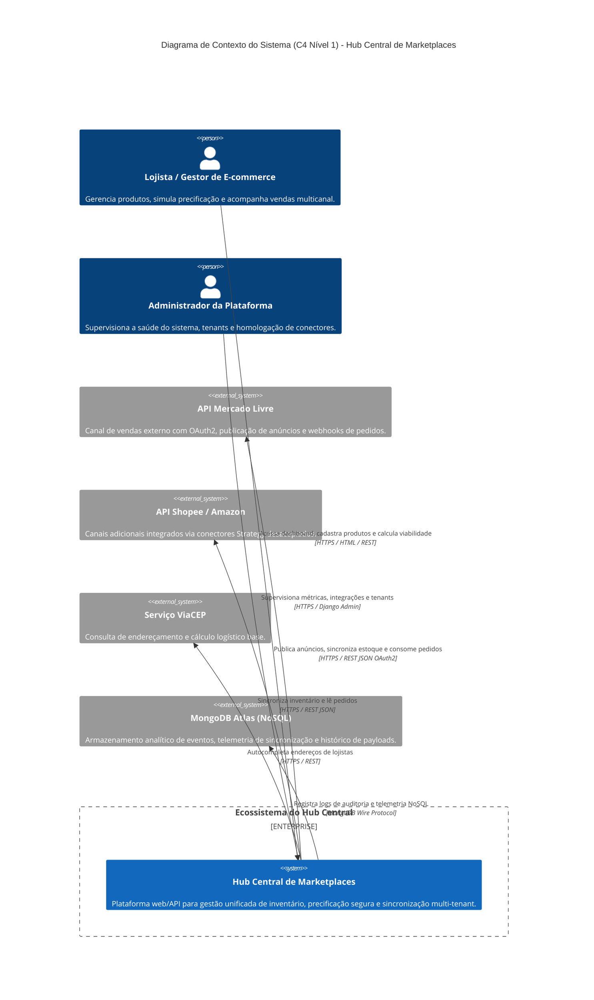
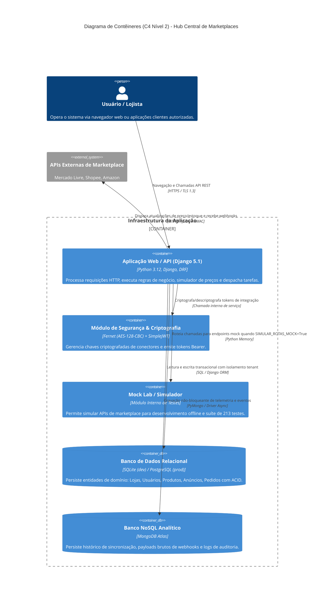

# Os códigos foram gerados com auxilio de I.A.
# Arquitetura de Software — Hub Central de Marketplaces

> **Disciplina:** Desenvolvimento Web III — FATEC Olímpia (2026/2)  
> **Professor:** Prof. Me. José Ceron  
> **Repositório:** [https://github.com/web3-fatec-olimpia-2026-2/hub_central_marketplace](https://github.com/web3-fatec-olimpia-2026-2/hub_central_marketplace)  
> **Status:** Sprint 3 — Em Conformidade com o Modelo C4

---

## 1. Visão Geral do Sistema

O **Hub Central de Marketplaces** é uma plataforma multi-tenant projetada para unificar a gestão de catálogos, a sincronização de inventário e a precificação estratégica de lojistas em múltiplos canais de comércio eletrônico (ex: Mercado Livre, Shopee, Amazon).

A arquitetura foi concebida sob os seguintes pilares:
1. **Isolamento Estrito Multi-Tenant**: Nenhuma consulta ou operação transita dados entre lojistas distintos.
2. **Resiliência e Idempotência**: Tratamento de instabilidades de rede de parceiros com *Circuit Breaker* e processamento idempotente de webhooks via hash de payload.
3. **Segurança em Profundidade**: Criptografia simétrica em repouso (Fernet AES-128) para segredos de autenticação externa e RBAC em 4 níveis.
4. **Inteligência Financeira**: Cálculo preditivo de viabilidade de campanhas antes da publicação de descontos.

---

## 2. Modelo C4 — Diagramas Arquiteturais

### 2.1 C4 Nível 1: Diagrama de Contexto do Sistema

O diagrama de contexto ilustra como os usuários interagem com o Hub Central e como o sistema se integra com os ecossistemas externos e serviços de suporte:



---

### 2.2 C4 Nível 2: Diagrama de Contêineres

O diagrama de contêineres detalha os componentes de software em execução, tecnologias envolvidas e protocolos de comunicação:



---

## 3. Arquitetura Modular e Bounded Contexts

O projeto é estruturado em módulos desacoplados no diretório `apps/`, onde cada módulo encapsula uma fronteira de negócio clara (*Bounded Context*):

```
apps/
├── tenancy/         # Governança Multi-Tenant (Modelo Loja, vínculo de usuários e querysets filtrados)
├── accounts/        # Identidade e Acesso (Usuários customizados, RBAC em 4 níveis e tokens JWT)
├── catalogo/        # Gestão de Produtos (Produtos, Categorias, Variações de SKU e Kits de Composição)
├── anuncios/        # Presença nos Canais (Mapeamento de anúncios, status de publicação e estados GoF)
├── marketplaces/    # Conectores Externos (Padrão Strategy, autenticação OAuth2 e Circuit Breaker)
├── financeiro/      # Inteligência Financeira (Calculadora de margens líquidas, taxas e viabilidade de campanhas)
├── pedidos/         # Processamento de Vendas (Ingestão de pedidos externos e baixa de estoque atômica)
├── mockar_dados/    # Ferramenta de Homologação (Mock Lab para testes de integração offline)
└── core/            # Utilitários Compartilhados (Modelos base com timestamps e middlewares de segurança)
```

---

## 4. Fluxos de Dados Críticos

### 4.1 Precificação e Cálculo de Viabilidade com Margem Garantida
1. O lojista informa o custo base do produto e os parâmetros da campanha (desconto percentual e canal alvo).
2. O serviço `CalculadoraViabilidadeService` consulta as comissões dinâmicas cadastradas para o marketplace específico.
3. Se a margem líquida calculada for inferior à margem mínima configurada pelo lojista, a plataforma **bloqueia a publicação** e alerta o risco de prejuízo financeiro.

### 4.2 Sincronização e Baixa Atômica de Estoque (Prevenção de Ruptura)
1. Uma venda é concluída em um marketplace parceiro, gerando uma notificação via webhook.
2. O webhook é recebido no endpoint seguro com validação de assinatura HMAC.
3. O serviço verifica o hash de idempotência no banco de dados para evitar reprocessamento duplicado.
4. É aberta uma transação atômica (`transaction.atomic()`) com bloqueio pessimista (`select_for_update()`) na linha do produto.
5. O estoque local é decrementado e um evento é disparado via *Observer Pattern* para notificar e atualizar o estoque em todos os demais marketplaces conectados.

---

## 5. Decisões Arquiteturais Chave (ADRs)

Todas as escolhas técnicas fundamentais foram documentadas formalmente sob o formato ADR em `docs/design/` e sintetizadas em [docs/decisoes.md](decisoes.md):

- **ADR-003**: Isolamento Estrito Multi-Tenant por Loja em todas as queries.
- **ADR-004**: Criptografia Fernet (AES-128 em CBC) para segredos de API em repouso.
- **ADR-005**: Padrão *Strategy* (GoF) para desacoplamento de conectores de canais externos.
- **ADR-007**: Padrão *Circuit Breaker* para tolerância a falhas em APIs externas instáveis.
- **ADR-008**: Idempotência e transações atômicas com lock pessimista em webhooks.
- **ADR-010**: Motor de Inteligência Financeira e viabilidade de campanhas.
- **ADR-012**: Arquitetura de Mock Lab com *Feature Flags* para execução rápida dos 213 testes.
